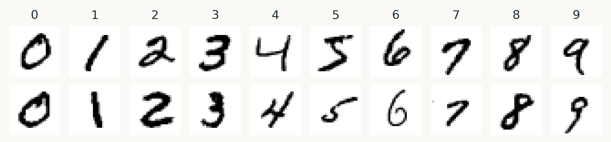
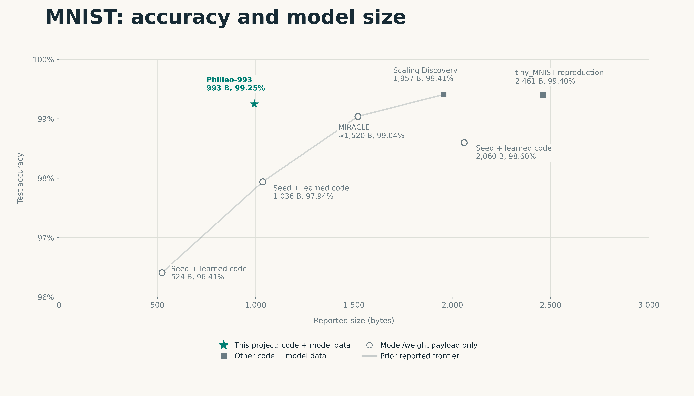
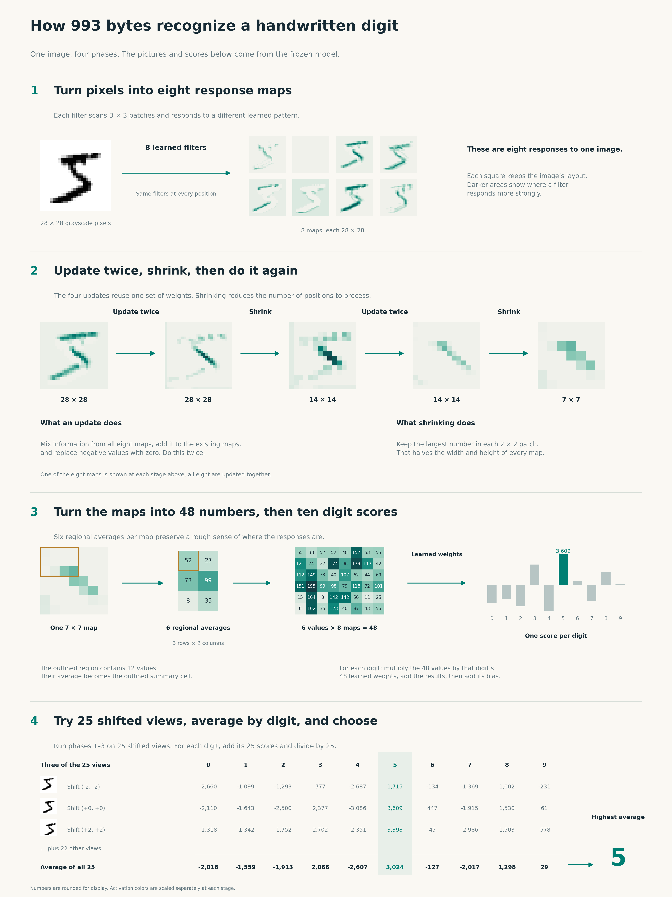
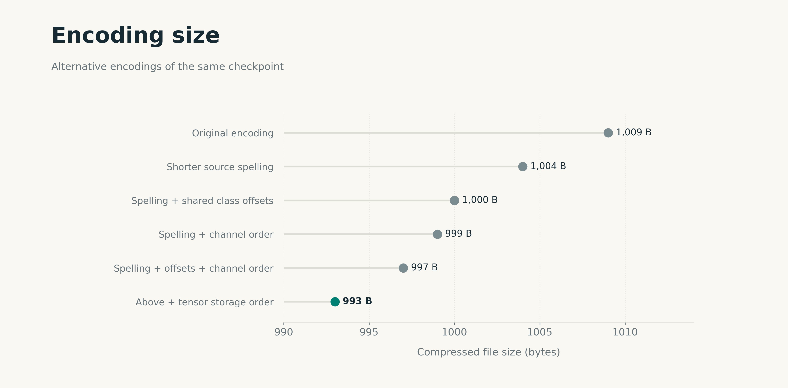
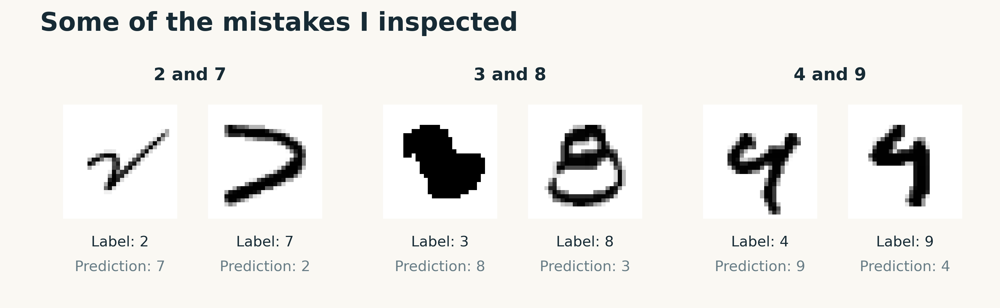

# **Handwritten Digit Recognition in 993 Bytes**

Yesterday, I watched 3Blue1Brown’s excellent video, [But what is a neural network?](https://www.youtube.com/watch?v=aircAruvnKk), which explains how neural nets can be trained to recognize handwritten digits on the MNIST database.

While MNIST already has plenty of highly accurate classifiers — LeNet-5 was above 99% accuracy by [1998](https://princetonuniversity.github.io/NEU-PSY-502/_static/pdf/Class%204/LeCunn1998.pdf) — watching Grant’s video made me curious about how small a model could get while still retaining high accuracy. It turns out that other people had this idea too! In 2018, the [MIRACLE](https://arxiv.org/html/1810.00440) researchers reported 99.04% accuracy using approximately 1,520 bytes of model data. In September 2026, [a team of four AI agents](https://arxiv.org/html/2609.21032v1) packed their model and inference code into 1,957 bytes at 99.41% accuracy. Inspired, I wanted to see if I could do better.

Working with Codex, I ended up with a **993-byte compressed Python file** that correctly classified **99.25% of the official MNIST test images**. For those unaware, 993 bytes is tiny. The raw pixels of one MNIST image take up 784 bytes, which means that the entire model weights and all of the custom code needed to reconstruct and run the network is only 209 bytes more than the raw pixels of one MNIST image. To my knowledge, this is currently the world’s smallest published MNIST classifier above 99% accuracy.

Download the [model](model/model.py.gz), or read the [source](model/model.py) and [evaluation report](EVALUATION.md) with full results and runtime details.

## What is MNIST?

[MNIST](https://keras.io/2/api/datasets/mnist/) is a dataset of 70,000 images of handwritten digits, from 0 to 9. Each image is a 28 × 28 grayscale grid, paired with a label identifying the digit. The dataset has 60,000 training images and 10,000 test images. Models learn to classify handwritten digits from the pixels of the training examples, and are then scored on the separate test set.



Compared to current LLMs, neural networks trained on MNIST to detect digits are extremely simple, which makes MNIST a fun environment for learning and experimentation on your own computer.

## Introducing the world’s smallest published MNIST model above 99% accuracy

Over the course of ~4 hours of iteration with ChatGPT, I trained a model, which I’m calling **Philleo-993**, that achieves **99.25%** accuracy on the official MNIST test set while only using **993 bytes** for its weights and custom code.

This model is the first to push the size–accuracy frontier below 1,000 bytes while staying above 99%, and it represents a significant improvement from prior attempts.



*Sizes follow each source’s accounting. Markers distinguish model data alone from code plus model data.* [***Sources and comparison details***](results/RELATED_WORK_DATA.md)*.*

**Other attempts:**

- [Scaling Discovery through Test-Time Communication](https://arxiv.org/html/2609.21032v1) reported a 1,957-byte classifier at 99.41% accuracy, developed by four collaborating AI agents. Like mine, its compressed submission includes code and model data. Philleo-993 is about 49% smaller, with slightly lower accuracy.

- [MIRACLE](https://arxiv.org/pdf/1810.00440) reported 99.04% accuracy in approximately 1,520 bytes of model data. My file is about 35% smaller, scores slightly higher, and includes the custom inference code.

- [Sahil Rajesh Dhayalkar’s Kilobyte Models](https://arxiv.org/html/2608.00860v1) takes a different approach: store a random seed and a short learned code, then regenerate the weights from those. It gets down to 524 bytes of model data at 96.41% accuracy. The larger models shown here reach higher accuracy, so there’s no single winner across every size and score.

## How I got it down to 993 bytes

Getting below 1,000 bytes meant working on the network, its training, and the file that stores it. I worked with ChatGPT Codex on all three areas, measuring the compressed size of each candidate. Visually, here’s what happens as a handwritten 5 passes through the model:



Here are the changes that made the model small enough:

- **Reusing the same weights.** The network first turns the image into eight feature maps, i.e. eight different responses to its strokes and shapes. It then updates those maps four times using one shared set of filters. Each update combines nearby information across all eight maps. After every two updates, max pooling keeps the strongest response in each 2 × 2 area, shrinking the maps from 28 × 28 to 14 × 14, then 7 × 7. Reusing the filters avoids storing four separate sets of weights.

- **Building the filters from fewer numbers.** The shared filters contain 576 weights, but the model learns two smaller arrays with 192 and 216 values. Multiplying those arrays reconstructs the filters. That means storing 408 values instead of 576.

- **Keeping the final scoring layer small.** Rather than connecting every remaining map position to every digit, the network averages six overlapping regions of each map. Eight maps × six averages gives 48 values. To score a digit, the final layer multiplies those values by 48 learned weights, adds them up, and adds a learned bias. It does this once for each of the ten digits.

- **Training with rounded weights.** Codex used quantization-aware training, i.e. rounding weights during training so the model could learn to work with fewer possible values. The file stores small integer codes and scale factors, which are converted back into decimal weights when loaded. A larger teacher model’s predictions also guided training, but the teacher is not needed to run the finished model. I kept asking Codex to measure the tradeoff between accuracy and compressed size. Giving one of the two filter arrays twice as fine a spacing produced ten more correct training predictions than its matched control, but left the file at 1,009 bytes. The [supporting material](preview/SUPPORTING.md) has the experiment details.

- **Running the same model on shifted images.** The classifier runs on 25 versions of each image, shifted by −2 to +2 pixels horizontally and vertically. It adds each digit’s scores across all 25 views and picks the highest total.

- **Making the file compress better.** To get from 1,009 bytes to 993, Codex shortened the Python code and searched for weight arrangements that gzip could compress more tightly, which I thought was quite clever. Reordering the feature maps and their connected weights changes the stored bytes and preserves the intended calculation. Other savings came from changing the order of the stored arrays, shifting all ten scores by a common amount, and adjusting how gzip encoded the file.



## Could Codex edit the weights?

After I achieved this result, I was curious to see whether Codex could improve the model by inspecting and editing individual weights directly. A network this small seemed like something we could understand in detail, and I had recently seen interesting research about weight-space programming, where an LLM reads and edits neural network weights directly. In [Sparks of Weight-Space Programming](https://rikiyat.github.io/blog/weight-space-programming/), researchers reported fixing a simulated car’s tendency to get stuck on a ramp by editing its network to reverse first, then accelerate. I asked Codex to build tools that showed the weights, layer activations, and mistakes. The model most often confused 2 with 7, 3 with 8, and 4 with 9 — and to be fair, those examples were quite challenging for a human to decipher too.



Training examples misclassified by the earlier 996-byte model.

I looked through examples and suggested directions, while Codex used the tools to investigate and test changes. In one experiment on 4/9 confusion, a targeted weight edit fixed 16 mistakes but, unfortunately, broke 23 correct predictions elsewhere in the training subset, so I kept the original model.

## Try the model

With Python and PyTorch installed, load the file from the repository root:

```python
import gzip
from pathlib import Path

model = {}
exec(gzip.decompress(Path("model/model.py.gz").read_bytes()), model)
predict = model["predict"]
```

Pass `predict` a float32 PyTorch tensor with shape `[batch, 1, 28, 28]`, with pixel values between 0 and 1 and light strokes on a dark background. It returns one digit label per image.
