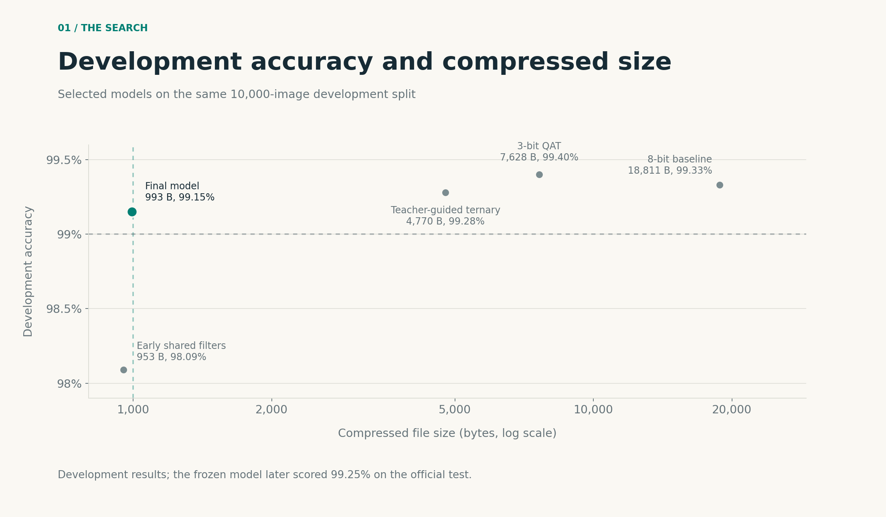

# MNIST Golf supporting material

[Return to the write-up](../README.md).

## Development results

The experiments used a 50,000-image training split and a 10,000-image development split drawn from MNIST’s training set. The development split was reused to compare candidates. These results are separate from the final official-test evaluation.

The selected models span different architectures and training procedures. They show the results found during the search, rather than isolating each technique’s contribution. The frozen model scored 99.15% on development data and 99.25% on the official test.

[Recorded figure data](../results/figure-data.json).

## Stored model data

The released model stores 986 integer codes for its weights and biases, plus seven scale constants. The code reconstructs float32 tensors for inference. The 993-byte archive expands to 1,571 bytes of Python source.

The shared convolution has 576 reconstructed weights, represented by 408 factor values. The factors contain 192 and 216 values respectively. Their matrix product supplies the kernel reused across all four residual updates.

The finer-precision experiment gave the left factor half the original code spacing. Both training arms used the same starting weights, teacher, optimizer and 32-epoch schedule. The finer grid produced ten more correct training predictions than its coarse control, but occupied 1,009 bytes. Its later encoding became the released model.

[Readable model](../model/model.py) and [manifest](../model/manifest.json).

## Encoding details

The size search combined shorter source, common class offsets, channel permutations and tensor storage order. The chart in the main article shows alternative combinations, not independent savings that can be added together.

For a feature in the linear readout, adding the same value to its weight for all ten classes adds the same amount to all ten output scores. In exact arithmetic, this preserves their ordering. Some such offsets make the stored integers compress better.

Reordering channels requires updating all dependent weights consistently. Although the intended function is unchanged, floating-point summation order can affect rounding. The final encoding matched the 1,009-byte parent’s predictions on all 50,000 training examples.

The archive is a single gzip member, with compression level 9, timestamp zero and no filename. Its DEFLATE stream uses a `Z_BLOCK` flush after source byte 991, then compresses the remaining source before finishing the stream. This block boundary is part of the size optimization; ordinary gzip compression of the source may produce a larger file. The download and SHA-256 in the manifest identify the exact evaluated bytes.

## Inspecting 4 and 9 mistakes

After the eventual release candidate existed, a separate research branch paired 18 misclassified training images with correctly classified examples of the same digit. Swapping the late upper region of one channel from a correct example into its mistaken counterpart repaired 15 of the 18 mistakes. The reverse swap broke three correct controls.

These swaps were diagnostic interventions using donor examples, not a deployable prediction method. A follow-up tested edits to the shared filter that produced that channel. All six candidates checked on the 25,000-example training subset lost accuracy. One fixed 16 mistakes and broke 23 correct predictions. No candidate advanced to development or official-test evaluation.

The findings helped distinguish an intervention that repaired specific examples from a weight edit that improved the classifier overall.

## Evaluation and sources

The [evaluation report](../EVALUATION.md) records the official-test result, uncertainty interval, runtime and checksums. The [comparison source table](../results/RELATED_WORK_DATA.md) documents prior work, byte accounting and the plotted frontier.
